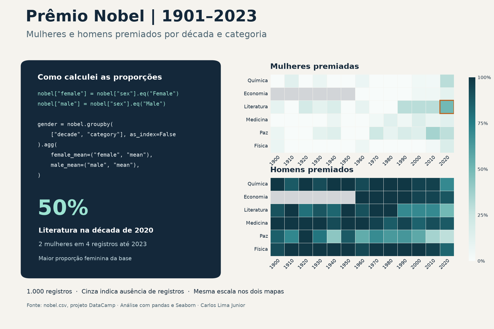

# História do Prêmio Nobel em Python

Análise exploratória de 1.000 registros do Prêmio Nobel entre 1901 e 2023. O projeto começou como um exercício do DataCamp e foi ampliado com mapas de calor para comparar as proporções de mulheres e homens por década e categoria.

## Resultados

- Literatura na década de 2020 teve a maior proporção de mulheres, com 50% (duas mulheres em quatro registros até 2023).
- A proporção de homens atingiu 100% em 31 combinações de década e categoria. O primeiro empate na ordem do DataFrame foi Química na década de 1900.
- Marie Curie foi a primeira mulher premiada na base, em Física, em 1903.
- Os Estados Unidos foram o país de nascimento mais frequente, com 291 registros.

O denominador das proporções inclui todos os registros de cada grupo, inclusive os que têm sexo ausente. As duas visualizações usam a mesma escala de 0% a 100%.

## Como executar

1. Instale as dependências com `python -m pip install pandas numpy seaborn matplotlib`.
2. Obtenha `nobel.csv` no [projeto do DataCamp](https://www.datacamp.com/projects/1888) e coloque-o ao lado de `analise_nobel.py`.
3. Abra a pasta no VS Code e execute as células `# %%` em ordem na janela interativa do Jupyter. Os gráficos e as respostas aparecem na janela interativa.

O [relatório de análise e revisão](relatorio_nobel.txt) descreve o método, os resultados e o tratamento de empates.
