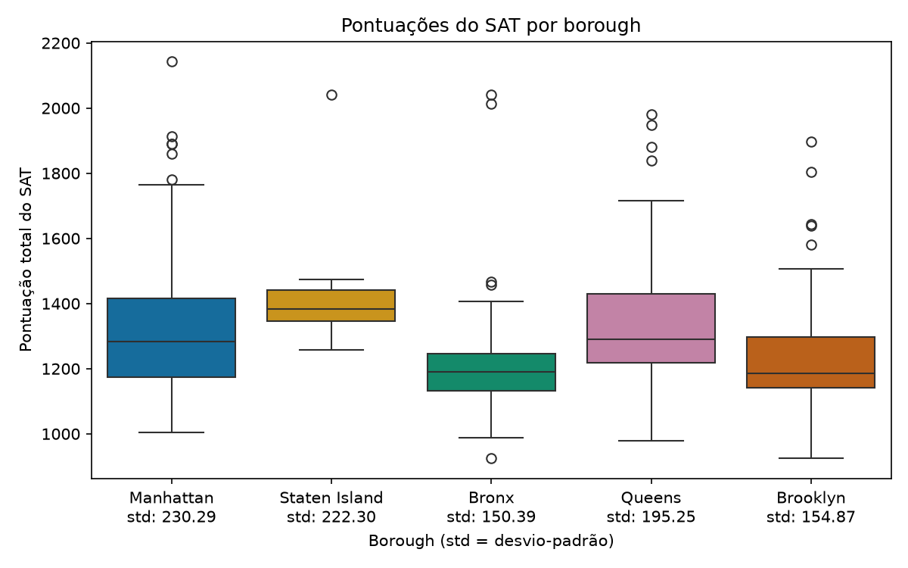

# Resultados do SAT nas escolas públicas de Nova York

Análise exploratória de 375 escolas públicas de Nova York. O script usa pandas para identificar as escolas com pelo menos 640 pontos em matemática, selecionar as dez maiores pontuações totais e comparar os resultados entre os cinco boroughs. [Projeto do DataCamp](https://www.datacamp.com/projects/1596)

Manhattan apresenta o maior desvio-padrão, com **230,29 pontos**. O borough tem **89 escolas** no conjunto de dados e pontuação total média de **1 340,13 pontos**. Os 20 valores em falta estão na coluna `percent_tested`.



O script também gera um gráfico de barras com a média de matemática por borough em três faixas: até 500, de 501 a 639 e a partir de 640 pontos. Staten Island não tem escolas na faixa intermédia neste conjunto de dados.

## Como executar

Coloca uma cópia de `schools.csv` do DataLab do DataCamp na mesma pasta do script. Com Python 3.13, abre um terminal nessa pasta e executa os comandos abaixo.

```bash
python3 -m venv .venv
source .venv/bin/activate
python -m pip install -r requirements.txt
python análise_schools.py
```

No VS Code, também podes executar as células `# %%` de cima para baixo.
